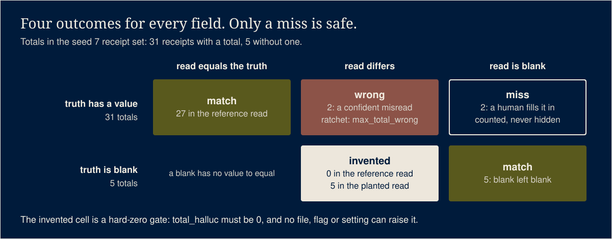

# llm-eval-gates

On October 5, 2026 a model update to my receipt reader failed its gate: eight wrong totals against
a floor of seven. It did not ship. Before I had the gate, a bake-off that proved one model better
than another lived in a scratch folder and taught nothing. These are the eval gates I run now before
any model or prompt change ships: a golden set, a baseline that only ratchets up, hard-zero gates for
invented values, a harness that must reproduce its own pinned numbers before its verdict counts, and
a judge from a different model family than the candidate. The golden data here is generated, because
the real one is full of real people.

## What it does


Four eval harnesses that share one pattern, plus the generator that invents their golden sets.
Node 20 or newer, zero dependencies, no model needed to run any of it.

| Harness | What it grades | The hard-zero gate |
|---|---|---|
| `scripts/receipts-eval.mjs` | A model's read of a receipt: vendor, date, document number, total, VAT, type | `total_halluc`: a total invented where the receipt has none |
| `scripts/surveys-eval.mjs` | A model's read of a handwritten feedback form: contact details, ratings, free text, one consent box | `consent_halluc`: a newsletter mark invented on a blank box |
| `scripts/voice-eval.mjs` | A model's summary of a meeting transcript | `name_halluc`: a person's name the transcript never says |
| `scripts/chatbot-eval.mjs` | A bot's answer to a question, given the context a fetch returned | `empty_fetch_halluc`: an answer where the right reply is "I don't have that" |

Each one does the same five things in the same order:

1. **Proves itself.** It scores a recorded reference read and must reproduce the numbers pinned
   in `eval/<domain>/self-test.json`. Then it scores a planted read with invented values and must
   catch them. If either fails it prints `SELF-TEST FAIL` and gives no verdict.
2. **Refuses an empty room.** A money eval with no money in it is untested. So is an
   invented-total gate with no blank total to invent on. The receipts harness refuses a set
   without both kinds; the surveys harness wants a marked and a blank consent box; the voice
   harness wants a name to check; the chatbot harness wants an empty-fetch case and an
   escalation case.
3. **Scores the candidate's recorded reads**, one JSON line per case.
4. **Applies the hard-zero gates.** Every count of invented values, and every unsafe-answer
   count, has a limit of zero in a frozen constant in `lib/gates.mjs`. No flag, environment
   variable or baseline file can raise it.
5. **Applies the ratchet gates** from `eval/<domain>/baseline.json`: wrong-value counts,
   accuracy floors, coverage. A missing baseline is itself a `GATE FAIL`. `scripts/rebaseline.mjs`
   writes the first one only with `--init`, and after that only ever moves the floors tighter.

The verdict is one `GATE PASS` line, or one `GATE FAIL <key> ...` line per failed gate and exit 1.

## Run it

```bash
npm ci                                   # no dependencies; checks the lockfile
npm run self-test                        # all four harnesses prove themselves
node scripts/receipts-eval.mjs --results eval/receipts/reference-read.jsonl
node scripts/receipts-eval.mjs --results eval/receipts/planted-halluc.jsonl   # GATE FAIL total_halluc 5 > 0
```

No arguments runs the self-test only. The flags, the same on every harness:

| Flag | What it does |
|---|---|
| `--results <file>` | Score these recorded reads against the golden set. |
| `--golden <file>` | Use this golden set instead of the shipped one. |
| `--dry` | Load the golden set and run the empty-room checks, score nothing. |
| `--judge --candidate <id> --judge-model <id>` | Chatbot only: add the advisory judge (below). |

Any other argument is refused, and so is `--dry` or `--self-test` next to `--results`: a run that names reads
always ends in a verdict. There is no switch that changes a gate.

**Your own data.** Keep the real golden set outside git, in a folder under your home directory,
and point `--golden` at it. Voice cases point at their transcript by path (relative to the golden
file) and pin it by digest, so the transcript can stay on the machine that holds it. Record your
model's reads with whatever runs your model, one JSON line per case, then score them:

```text
receipts  {"receipt_id": "rcpt-0001", "draft": {"vendor": "...", "date": "2026-03-14", "total": "1,284.50", ...}}
surveys   {"form_id": "form-0001", "draft": {"intake": {...}, "feedback": {"newsletter_opt_in": null, ...}}}
voice     {"id": "vc-0001", "summary": {"title": "...", "summary_short": "...", "key_takeaways": [], "action_items": []}}
chatbot   {"id": "cb-0001", "answer": "..."}
```

The case shapes are in `eval/<domain>/golden.jsonl`; the generator in `lib/generate.mjs` is the
reference for every field.

**After an intentional improvement**, ratchet the floor in the same change:

```bash
npm run rebaseline -- receipts --results better-reads.jsonl
```

It runs the self-test, refuses a run that fails any gate, and writes the stricter of the old limit
and the new measurement for every ratchet gate. It refuses when there is no baseline yet. The
first baseline for a new domain or a new set is written once, on purpose, with `--init`, which
refuses when a baseline already exists:

```bash
npm run rebaseline -- --init receipts --results first-reads.jsonl
```

**The judge** (chatbot only, off by default) grades each answer against its context with a second
model and prints a score. It never gates. It runs only when `JUDGE_URL` points at an
OpenAI-compatible endpoint (`JUDGE_API_KEY` if that endpoint needs one), and it refuses a judge
from the candidate's own model family, or from a family it cannot identify, before any call:

```bash
node scripts/chatbot-eval.mjs --results answers.jsonl --judge --candidate qwen-7b-example --judge-model qwen-large-example
# refusing the judge: qwen-large-example and qwen-7b-example are the same model family (qwen); a judge never grades its own family
```

**The golden sets** are generated: `npm run golden` writes `eval/` from seed 7, and
`node scripts/generate-golden.mjs --seed 12 --out /tmp/set` writes another set anywhere. Every
business, person, address and amount is invented by code. The generator also draws each receipt
and form as an SVG image beside the set (git ignores them), for anyone who wants to run a vision
model over the same cases.

## Test it

[](https://github.com/jaysueno/llm-eval-gates/actions/workflows/ci.yml)

```bash
npm ci
npm test
```

42 tests in seven files, no model and no network.

- `test/harness.test.mjs` runs the four harnesses as a user would. Every self-test passes and
  prints its pinned numbers; every reference read passes; every planted read trips its hard
  gate. Then it tries to cheat: a pinned number off by one (no verdict at all), an all-blank set
  and a set with no blank case (refused), environment knobs set to 999, an override flag, a
  baseline that sets `total_halluc` to 999, and no baseline at all. The planted read fails every
  time, and a clean read with no baseline fails too. `rebaseline` refuses to write a first
  baseline without `--init` and refuses `--init` when one exists. A transcript edited after it was pinned is refused.
- `test/judge-family.test.mjs` proves the judge is refused for nine same-family pairs and for
  unknown families on either side, and accepted for different families, at the library and at
  the command line.
- `test/generator.test.mjs` proves seed 7 rebuilds the committed `eval/` files byte for byte.
- `test/gates.test.mjs`, `test/compare.test.mjs`, `test/names.test.mjs`, `test/tier-a.test.mjs`
  pin the frozen table, the four outcome classes, the name check and the chatbot's deterministic
  checks.

## How it works



```text
 eval/<domain>/golden.jsonl  (generated, seed 7)        your reads.jsonl
            |                                                 |
            v                                                 |
   self-test: reference-read.jsonl must reproduce             |
   self-test.json, planted-halluc.jsonl must trip   -- no --> SELF-TEST FAIL, exit 2
            | yes                                             |
            v                                                 v
   empty room? (no money, no blank, no name)        -- yes --> refusing: ..., exit 1
            | no
            v
   score every case: match / miss / wrong / invented
            |
            v
   lib/gates.mjs HARD_ZERO (frozen, 0)  +  baseline.json ratchets (only tighten)
            |
            v
   GATE PASS, exit 0        or        GATE FAIL <key> ..., exit 1
```

### Four outcomes, and why blank and wrong are kept apart

Every field read lands in one class. A **match** is right, including a blank field left blank. A
**miss** leaves a filled field blank: a person fills it in and loses a few seconds. A **wrong**
read puts a different value in: it goes into the books looking exactly like a right one. An
**invented** value fills a field that is blank on the page. Accuracy alone hides the difference;
a model that guesses instead of leaving a blank can score higher and do more damage. So the wrong
count has its own ratchet, and the invented count is a hard zero.

### Hard zero lives in code, ratchets live in data

The zero is a frozen constant in `lib/gates.mjs`, a module that reads no flag and no
environment. The ratchets live in `baseline.json`, and that file is guarded too. A missing
baseline fails the run with `GATE FAIL baseline_missing`, because deleting the file would
otherwise be the cheapest way to drop every floor; the hard gates are still evaluated. A
baseline that names a hard-zero key fails the run with `GATE FAIL baseline_integrity`, because a
file that loosens a safety gate is the change this repo exists to block.

### A harness proves itself before its verdict counts

The self-test is cheap and runs on every invocation. It scores the shipped reference read and
compares each number with its pin. If someone edits the scorer, the comparison, or the set, the
pins stop matching and the harness says so before it scores anything. The planted read proves the
other direction: the detector for invented values actually fires. A check that has never caught
anything has not been tested.

### The judge comes from another family

A model grading its own family rates its own phrasing as correct and shares its blind spots.
`lib/judge.mjs` maps a model id to the lab that trained it (`qwen-7b-example` and `qwen/qwen-judge-example`
are one family; `gemma` and `gemini` are one family) and refuses the pair when the two match or
when either is unknown. The judge grades only against the context the answer was given, and its
score is advice. Tier A, the deterministic checks, carries the gate.

### The chatbot's deterministic checks

`lib/tier-a.mjs` checks each answer against its case: expected facts and citations present, an
empty fetch declined, an escalation made when the case needs one, no owner-only detail leaked, no
em dash and no promised health outcome. Its factuality tripwire fails any significant number in
the answer (a decimal, a thousands comma, a currency sign, four or more digits) that is not in the
context. Before scoring, every case's prompt must fit its context window with room for the answer,
or the model never saw the whole context and the eval would pass on a prompt it could not read.

## What it will not do

- **It does not run your model.** It scores reads you recorded. Tools like promptfoo run models
  and collect outputs; this repo is the gate you put after them.
- **The numbers in `eval/` say nothing about any real model.** The reference read comes from a
  simulated reader with a fixed mix of right, blank and wrong answers. It exists so the self-test
  has numbers to reproduce.
- **The name check is a heuristic.** A capitalized word that is not in the built-in word list
  (`lib/words.mjs`) counts as a possible name. Unusual ordinary words need adding to the list,
  and real names that belong in a summary go on that case's `names_allow_extra`.
- **The judge never decides.** It is off unless `JUDGE_URL` is set, and its score is printed,
  not gated.
- **It ships no real data and sends nothing anywhere.** Every test runs offline.

## License

MIT. See `LICENSE`.
